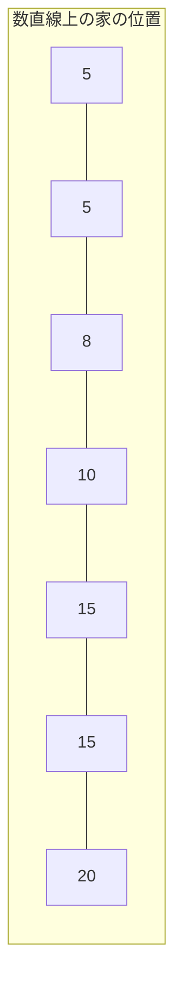
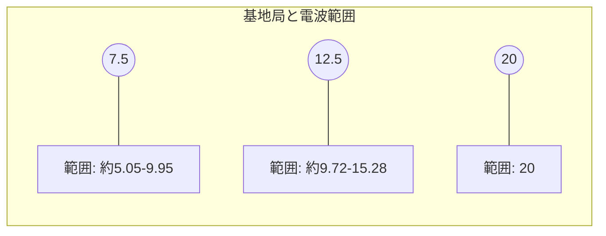
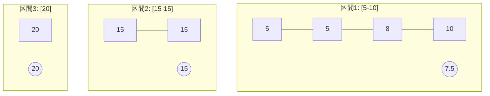

# D - Transmission Mission（電波伝送問題）の解説【視覚化版】

## 問題の視覚化

この問題を視覚的に理解するために、サンプル例で説明します。

上の図は、7つの家が座標5, 5, 8, 10, 15, 15, 20に位置していることを示しています。

## 電波の届く範囲

基地局を座標rに置き、電波強度をxとすると、電波は[r-√x, r+√x]の範囲に届きます。

例えば、基地局を座標7.5に置き、電波強度を6に設定すると：
- 電波の届く範囲は [7.5-√6, 7.5+√6] = [約5.05, 約9.95]
- つまり、座標5, 5, 8にある家には電波が届きますが、座標10の家には届きません

## 最適な配置の考え方

各区間での最適な基地局配置は、区間の両端の座標の中間点です。例えば：

- 区間1：基地局を座標7.5に置き、電波強度は((10-5)/2)²=6.25→切り上げて7
- 区間2：基地局を座標15に置き、電波強度は0
- 区間3：基地局を座標20に置き、電波強度は0

これらの電波強度の合計は7+0+0=7です。しかし、これが最適解とは限りません。

## 区間分割の考え方

最適な区間分割を考えるために、隣接する家の距離を見てみましょう：

M=3の場合、2つの切れ目を入れる必要があります。大きな距離がある場所で切るのが直感的には良さそうです。
距離5が2箇所あるので、そこで区切ると：

- 区間1：座標5, 5, 8, 10の家
- 区間2：座標15, 15の家
- 区間3：座標20の家

しかし、問題の解説画像によれば、最適な分割方法は異なるようです。画像から読み取れる分割は：

- 区間1：座標5, 5, 8, 10の家
- 区間2：座標15, 15, 20の家

この場合：
- 区間1の電波強度：((10-5)/2)²=6.25→7
- 区間2の電波強度：((20-15)/2)²=6.25→7

合計は14で、これは先ほどの分割方法より悪くなります。

実際には、最適な分割方法や基地局の配置方法は、単純に距離だけでは決まらない場合があります。例えば：

- 区間1：座標5, 5, 8の家（基地局は座標6.5）
- 区間2：座標10の家（基地局は座標10）
- 区間3：座標15, 15, 20の家（基地局は座標17.5）

この場合の電波強度は：
- 区間1：((8-5)/2)²=2.25→3
- 区間2：0
- 区間3：((20-15)/2)²=6.25→7

合計は3+0+7=10となります。

この問題の難しさは、最適な区間分割と基地局配置を同時に考える必要がある点です。単に隣接する距離が大きい場所で分割するだけでなく、各区間での必要な電波強度も考慮する必要があります。
